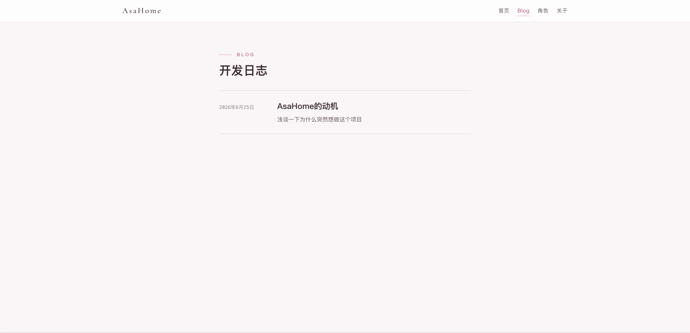
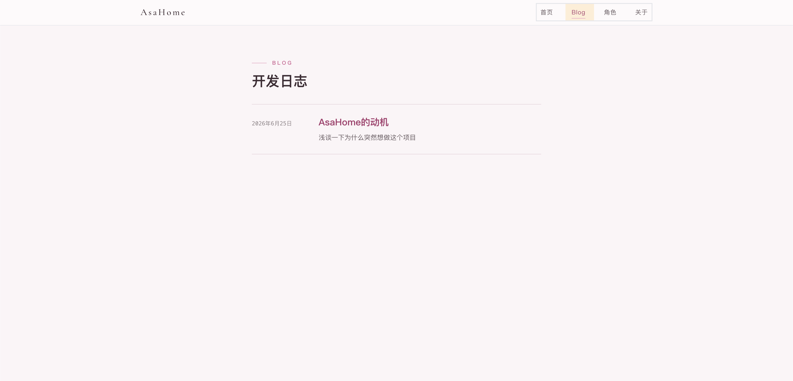

# 导航栏 CSS 改造（一）：滑块与层叠上下文

## 原来的样子



代码

```tsx
"use client";

import Link from "next/link";
import { usePathname } from "next/navigation";

const navItems = [
  { href: "/", label: "首页" },
  { href: "/blog", label: "Blog" },
  { href: "/characters", label: "角色" },
  { href: "/about", label: "关于" },
];

export function Header() {
  const pathname = usePathname();

  return (
    <header className="sticky top-0 z-20 border-b border-border/60 bg-white/70 backdrop-blur-md">
      <nav className="max-w-content mx-auto px-6 h-14 flex items-center justify-between" aria-label="主导航">
        <Link href="/" className="font-display text-xl font-medium tracking-[0.15em] text-ink">
          AsaHome
        </Link>

        <ul className="flex items-center gap-5 text-[0.8125rem] tracking-wider">
          {navItems.map((item) => {
            const isActive =
              item.href === "/"
                ? pathname === "/"
                : pathname.startsWith(item.href);

            return (
              <li key={item.href}>
                <Link
                  href={item.href}
                  aria-current={isActive ? "page" : undefined}
                  className={`transition-colors ${
                    isActive
                      ? "text-brand-600 underline underline-offset-8 decoration-brand-300"
                      : "text-ink-soft hover:text-brand-600"
                  }`}
                >
                  {item.label}
                </Link>
              </li>
            );
          })}
        </ul>
      </nav>
    </header>
  );
}

```

## 现在的样子



代码

```tsx
"use client";

import Link from "next/link";
import { usePathname } from "next/navigation";

const navItems = [
  { href: "/", label: "首页", index: 0 },
  { href: "/blog", label: "Blog", index: 1 },
  { href: "/characters", label: "角色", index: 2 },
  { href: "/about", label: "关于", index: 3 },
];

export function Header() {
  const pathname = usePathname();
  const current = navItems.find(s =>
      (s.href === "/" ? pathname === "/" : pathname.startsWith(s.href))
 );

  return (
    <header className="sticky top-0 z-20 border-b border-border/60 bg-white/50 backdrop-blur-md">
      <nav className="max-w-content mx-auto px-6 h-14 flex items-center justify-between" aria-label="主导航">
        <Link href="/" className="font-display text-xl font-medium tracking-[0.15em] text-ink">
          AsaHome
        </Link>

        <div className="flex relative items-center gap-10 text-[0.8125rem] tracking-wider border-2 p-2">
          {navItems.map((item) => {
            {/* Get the current path */}
            return (
              <div key={item.href}>
                <Link
                  href={item.href}
                  aria-current={current?.label === item.label ? "page" : undefined}
                  className={`transition-colors ${
                    current?.label === item.label
                      ? "text-brand-600 underline underline-offset-8 decoration-brand-300"
                      : "text-ink-soft hover:text-brand-600"
                  } z-10 relative
                  `}
                >
                  {item.label}
                </Link>
              </div>
            );
          })}
          <div
                className="absolute top-0 left-0 w-1/4 p-2 z-0 h-full bg-orange-100"
                style={{
                  transform: `translateX(${current?.index * 100}%)`,
                  transition: "transform 0.3s ease-out"
                }}
          >
          </div>
        </div>
      </nav>
    </header>
  );
}
```

## 层叠上下文

可以看到明显变丑了，因为目前只是添加了一个边框和一个选择框，给选择框加上了 translateX 和 transition 罢了。

一开始使用 z-index 管理选择框和文字的层叠关系的时候，发现选择框背景颜色总是覆盖在文字上方，于是直接给选择框加了一个 z-0，给 map 出来的导航元素加了 z-10

```tsx
{/* add a z-10 for nav item*/}
className={`transition-colors ${
  current?.label === item.label
    ? "text-brand-600 underline underline-offset-8 decoration-brand-300"
    : "text-ink-soft hover:text-brand-600"
} z-10`}
```
```tsx
{/* add a z-0 for bg chosen block*/}
className="absolute top-0 left-0 w-1/4 p-2 z-0 h-full bg-orange-100"
```

发现背景仍然在上方，于是询问 AI，学到了层叠上下文的知识，大致如下：
- 多个元素在视觉上重叠时，要决定绘制的顺序，后绘制的会在先绘制的上方
    - 元素的背景和边框会先于元素的内容绘制
    - 浏览器先绘制非定位元素，再绘制定位元素
- 用 z-index 控制层叠关系的时候，首先需要保证对应的元素是定位元素（非 static 的）
    - 例外：Flex 和 Grid 项目的直接子元素 z-index 也生效
    - 本例中，`Link`外面还有一层 `div`，因此非直接子元素，z-index 没有生效
- 层叠上下文：可以大致这样理解：
```
文件夹 A：z-index 1
  └── 图片：z-index 9999

文件夹 B：z-index 2
  └── 图片：z-index 0
```
即便 A 内部图片的 z-index 是 9999，它也无法跑到 B 上面，因为整个文件夹 A 的层级低于文件夹 B。

- 一个比较关键的问题，什么元素会创建层叠上下文？
    - 页面根元素`<html>`默认创建最底层的层叠上下文（根目录）
    - **定位元素 + 非 AUTO 的 z-index**
    - position: fixed or sticky

再来看看为什么背景块仍位于 nav item 上方：
```
页面根层叠上下文
└── header 层叠上下文：sticky + z-20
    └── 导航容器：relative，但没有 z-index
        ├── 蓝色框：absolute + z-0
        ├── 普通外层 div
        │   └── Link：z-10，但不是定位元素，也不是 flex item
        └── 普通外层 div
            └── Link：z-10，但不是定位元素，也不是 flex item
```
- 蓝色框创建了新的层叠上下文，而 link 元素没有，默认位于 header 的层叠上下文中，属于普通文档流
- 而header层叠上下文的绘制顺序：
    1. header 自身的背景和边框
    2. z-index 为负数的定位层叠上下文
    3. 普通文档流中的块级元素
    4. 普通行内内容，例如文本
    5. z-index: auto 或 z-index: 0 的定位元素及层叠上下文
    6. z-index 大于 0 的定位层叠上下文
- 因此 z-index = 0 的蓝色框就位于上方了

## Flex 布局问题

我们看到蓝色框的父元素有`Flex`，为什么蓝色框确没有按 Flex 一样平铺呢？
因为`position: absolute`使得元素脱离了普通文档流，不参与 flex 布局
