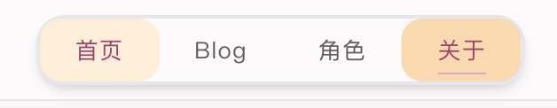

# 导航栏 CSS 改造（三）：滑动选中块与悬停反馈

## 效果


## 新的代码

```tsx
function ChosenBlock({index, z, bgColor}:{index: number; z: number; bgColor: string;}){
  if(index === -1) return null
  return <div
          className={`absolute top-0 left-0 w-1/4 p-2 h-full ${bgColor} rounded-xl transition-transform duration-300 ease-out`}
          style={{
            transform: `translateX(${index  * 100}%)`,
            zIndex: z
          }}
    >
    </div>
}

export function Header() {
  const pathname = usePathname();
  const current = navItems.find(s =>
      (s.href === "/" ? pathname === "/" : pathname.startsWith(s.href))
 );
 const [hoverIndex, setHoverIndex] = useState(-1);

  return (
    <header className="sticky top-0 z-20 border-b border-border/60 bg-white/50 backdrop-blur-md">
      <nav className="max-w-content mx-auto px-6 h-14 flex items-center justify-between" aria-label="主导航">
        <Link href="/" className="font-display text-xl font-medium tracking-[0.15em] text-ink">
          AsaHome
        </Link>

        <div
          onMouseLeave={() => setHoverIndex(-1)}
          className="flex relative items-center text-[0.8125rem] tracking-wider border-2 rounded-2xl shadow-md"
          >
          {navItems.map((item) => {
            // Get the current path
            return (
                <Link
                  key={item.href}
                  href={item.href}
                  aria-current={current?.label === item.label ? "page" : undefined}
                  onMouseEnter={() => setHoverIndex(item.index)}
                  className={`transition-colors ${
                    current?.label === item.label
                      ? "text-brand-600 underline underline-offset-8 decoration-brand-300"
                      : "text-ink-soft hover:text-brand-600"
                  } z-10 relative flex px-5 items-center justify-center py-2
                  `}
                >
                  {item.label}
                </Link>
            );
          })}
          {/* Select Block */}
          <ChosenBlock index={current?.index ?? -1} z={5} bgColor="bg-orange-200"/>

          {/* Hover Block */}
          <ChosenBlock index={hoverIndex} z={0} bgColor="bg-orange-100"/>
        </div>
      </nav>
    </header>
  );
}
```

## 说明

就是加了个如果鼠标悬浮到另一个导航项，用一个更浅色的选择框选中，移动有 transform 效果，仅此而已，但实际实现的过程中还是学到了很多的。

设计思路大概是：
- 并不是用 CSS 的 `:hover` 来控制，因为这不是改变 Link 组件本身的样式
- 单独用一个选择框组件来，使用 `useState` 代表当前位于什么导航项，onMouseEnter，onMouseLeave 控制 `setState`
- 这样不仅方便复用之前的代码，还可以方便的 transform 动效

### tsx 组件传参

- 跟普通 React 那种直接传入一个 props 的方式还是有挺大区别的
- 最好用 interface 声明一个参数类型接口：
```tsx
interface ButtonProps {
  text: string
  onClick: () => void
}
```
- 函数参数类型声明：
```tsx
function Button({ text, onClick }: ButtonProps) {
  return <button onClick={onClick}>{text}</button>
}
```

### TailWind CSS Style or className

- 核心就是一句话：静态样式用 className，动态样式用 Style
- 这里的静态样式指的是固定的，不需要运行时改变数值的，比如如果动态变化的是几套确定的样式组，那也应该使用 className 条件选择
- 动态样式指的是运行时计算的样式，比如这次中的 transform，zIndex
- style 的优先级高于 className

### 一些细节

关于 Link 这个东西，发现也能当成一个 div 用，比如将 Link 外部容器的 padding 放进 Link 内部后，点击空白部分也可以切换导航栏了，这是很符合直觉的，而且视觉上并没有改变。

一开始把 onMouseLeave 注册给了 Link，这显然不符合直觉，比如如果鼠标移到了空白部分，hover 框就会消失。后面发现可以直接注册给外层 div，这样就很符合直觉了。
